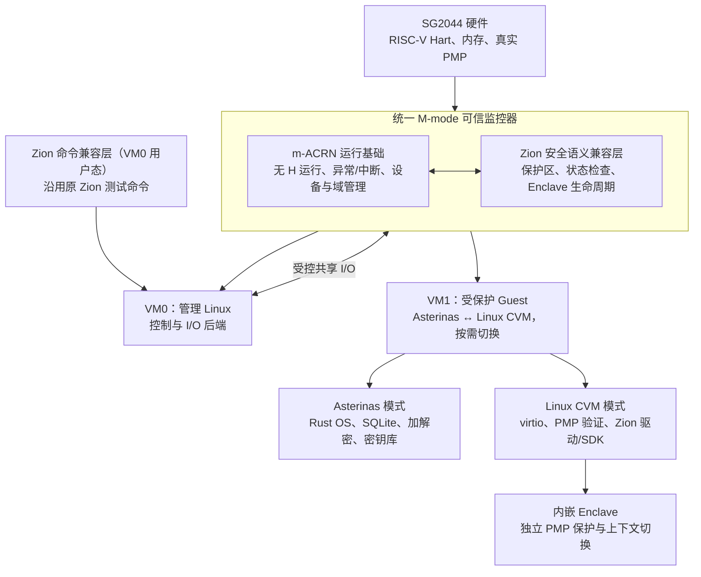
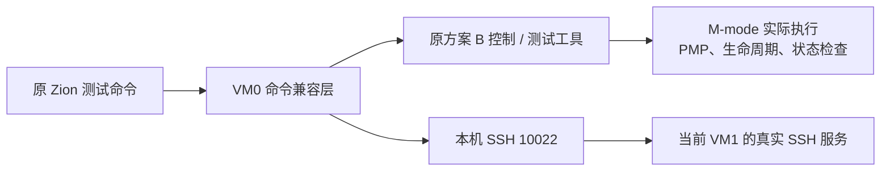

# SG2044 方案 B：m-ACRN 与 Zion 融合设计及十项指标评估

硬件平台：SG2044。方案由统一 M-mode 固件、两种 Guest 配置及 Zion 原命令兼容层组成。

说明总体架构、m-ACRN 与 Zion 的分工、引入命令兼容层的原因，以及对 `2-3-0001` 至 `2-3-0010` 十项指标的满足能力。

## 1. 设计目标与平台约束

方案 B 的目标是在 **不具备 RISC-V H 扩展的 SG2044** 上，利用 m-ACRN 的 M-mode 运行基础和真实 PMP，结合 Zion 的安全管理语义与 Enclave 软件组件，提供受保护操作系统、受控共享 I/O 和内嵌 Enclave 的运行环境。

上层使用原 Zion 测试命令；底层采用适合 SG2044 的执行与隔离机制。测试在目标板管理 Linux 内执行，使用该 Host 的本地 Guest 身份。

| 设计要求 | 方案选择 |
|---|---|
| SG2044 无 H 扩展 | 使用 M-mode 监控器、物理 Hart 分域和 PMP，不依赖 H/KVM 执行后端 |
| 运行 Rust TEE OS 及其应用 | VM1 承载 Asterinas，运行 SQLite、tee-crypto、tee-vault |
| 承接大纲中的 Linux CVM 场景 | VM1 也可承载 Linux CVM，提供 virtio 和原 Zion Enclave 组件 |
| 降低测试操作成本 | 保留 `zion-runtime.sh` 命令族和 `127.0.0.1:10022` SSH 入口 |
| 避免按用例更换固件 | 一套固件与统一载荷，VM0 持续运行，VM1 受控切换 |

**能力边界：按方案 B 的执行环境映射，九项具备功能满足路径；0004 要求实体 H 扩展及其虚拟化链路，本方案无法满足。** 命令兼容层不会补出硬件能力，也不表示原大纲所有软件环境和操作步骤可以原样使用。

## 2. 总体架构

### 2.1 架构图



VM0 与 VM1 是两个执行域。Asterinas 和 Linux CVM 共用 VM1，同一时刻运行其中一种；Enclave 与父 Linux CVM 共用 Hart，通过权限和上下文切换运行，不增加一个常驻 VM。

图中有两类适配，职责不同：**M-mode 内的 Zion 安全语义适配负责安全机制；VM0 用户态的 Zion 原命令兼容层负责操作接口。** 私有内存访问限制由监控器和 PMP 执行，命令兼容层只负责发起请求和呈现实际结果。

### 2.2 各层职责与信任边界

| 层次 | 组成与职责 | 与安全边界的关系 |
|---|---|---|
| 硬件 | SG2044 Hart、内存和 PMP | 执行实际 CPU 物理访问权限限制 |
| M-mode | m-ACRN 与 Zion 安全语义适配 | 保存私有上下文，管理 PMP、域生命周期、共享通道校验和 Enclave |
| VM0 | 管理 Linux、命令兼容层、控制工具与 I/O 后端 | 管理和服务域；其 CPU 访问仍受 PMP 约束，不能据管理权限直接访问 VM1 私有内存 |
| VM1 / Asterinas | Rust OS 及应用 | 提供 TEE OS 与应用验证环境 |
| VM1 / Linux CVM | Linux、virtio、Zion 驱动与 SDK | 提供大纲指定的 Linux CVM 和 Enclave 运行环境 |
| 内嵌 Enclave | Eyrie runtime 与受保护程序 | 在 CVM 内进一步隔离代码、数据和上下文，限制父 Guest 对其私有区的访问 |

VM0 的 I/O 后端通过显式共享窗口提供网络与块服务。监控器校验队列、地址、长度、序号和响应，再在 Guest 私有缓冲与共享区之间转移数据；后端不获得任意访问 VM1 私有 RAM 的权限。

## 3. m-ACRN 与 Zion 的融合方式

### 3.1 运行基础、安全语义与原组件复用

| 部分 | 方案 B 中的处理 |
|---|---|
| m-ACRN 运行基础 | 承担 SG2044 无 H 运行、域划分、异常与中断处理、虚拟设备服务和受控 Guest 切换 |
| Zion 安全管理语义 | 在统一监控器中适配私有内存保护、共享状态检查，以及 Enclave 创建、进入、恢复、退出和销毁 |
| Zion Guest 软件接口 | Linux CVM 内复用原驱动、SDK、Eyrie runtime、loader 和测试程序，对接监控器兼容服务 |
| Zion 上层命令接口 | VM0 使用同名 `zion-runtime.sh` 封装方案 B 后端，保持主要测试入口和 Guest 应用命令 |
| 原 H/KVM/tvm 后端 | 由方案 B 无 H 运行时、控制接口及设备后端承担对应功能；实体 H 扩展指标仍需 H 平台 |

融合采用**一套 M-mode 监控器、一套 PMP 与上下文管理机制**。m-ACRN 提供运行基础，Zion 相关安全服务在此基础上适配；原 Zion 的完整 H/KVM/tvm 执行栈没有整体搬入 SG2044。

### 3.2 三条主要运行链路

**应用链路：**启动 Asterinas → 通过 SSH 登录 → 运行 SQLite、加解密或密钥库应用。VM0 提供管理与 I/O 服务，PMP 限制域间 CPU 访问。

**共享通道检查链路：**VM0 后端发布 I/O 响应 → M-mode 检查共享字段 → 发现异常时保留私有上下文并产生告警。0008 中的 S3 是 Host 可写共享通道中的清洗后兼容字段，真实私有寄存器状态由监控器另行保管。

**Enclave 链路：**Linux CVM 内驱动与 SDK 发起请求 → M-mode 建立保护区并切换上下文 → Enclave 计算及 OCALL → 恢复并继续 → 销毁和清理。Enclave 的私有区还需要排除在父 Linux 的普通访问及 I/O 描述符可用范围之外。

### 3.3 m-ACRN 已能直接承载 Rust OS，为什么仍要融合 Zion

**Zion 不是 m-ACRN 启动 Rust OS 的必需依赖。** 完成 SG2044 板级适配后，m-ACRN 可以直接承载 Asterinas，提供运行、异常/中断、设备服务和基于 PMP 的域间隔离。若目标限于 Rust OS 启动、应用运行和基础内存分区，采用 m-ACRN 并正确配置这些机制即可形成独立方案。

方案 B 还需要承接大纲中的 CVM 共享通道篡改检测、CVM 内嵌 Enclave 和原 Zion 软件接口。融合 Zion 的价值，是复用这些安全管理语义及已有软件组件，减少重新设计接口、移植应用和组织测试的工作。

| 需要解决的问题 | m-ACRN 提供的基础 | 结合 Zion 的具体价值 |
|---|---|---|
| Rust OS 启动、应用及基础域隔离 | 无 H 运行、资源分域、设备服务、真实 PMP | 该能力可以由 m-ACRN 直接提供；引入 Zion 不改变 Asterinas 的直接承载关系 |
| Host 可写共享通道的状态检查 | M-mode 陷入处理、私有状态及受控 I/O 通道 | 适配 Zion 的共享状态检查语义，检测 S3 字段篡改、保留私有上下文并告警，对应 0008 |
| CVM 内进一步保护小型程序 | PMP、上下文切换及权限管理基础 | 复用 Zion 驱动、SDK、Eyrie runtime、loader 和 demo，在 M-mode 实现 Enclave 生命周期及父域/Enclave 隔离，对应 0010 |
| 沿用原有测试操作 | 方案 B 的实际控制工具和设备后端 | VM0 命令兼容层保留原 Zion 命令名称、SSH 入口和 Guest 应用调用，集中处理底层差异 |

这些安全服务也可以在 m-ACRN 上自行设计实现；本方案选择融合 Zion，是为了复用已有安全管理模型和软件接口。跨域 CPU 访问限制仍由统一 M-mode 监控器配置真实 PMP 实现；Rust 语言有助于减少 OS 内部内存错误，域间隔离和 Host 共享状态检查则需要上述运行时机制共同保证。

因此，当前承载关系仍是 **m-ACRN 直接运行 Asterinas**；Zion 相关安全语义适配进同一 M-mode 监控器。内嵌 Enclave 组件当前部署在 Linux CVM 配置内，Asterinas 与 Linux CVM 按需共用 VM1。VM0 的原命令兼容层只负责操作接口，不能替代 M-mode 安全机制。

## 4. 为什么引入 Zion 原命令兼容层

### 4.1 要解决的问题

原大纲以 `zion-runtime.sh`、固定 SSH 端口和 Guest 内应用命令组织操作。方案 B 底层使用 `planb-runtime.sh`、`planb-guestctl`、`planb-backend`、`macrn-pmp-test`，并且两种 Guest 使用不同子网。若直接暴露这些差异，上层测试需要改写启动、登录、切换和日志处理流程。

兼容层将这些差异集中在 VM0 用户态处理，使测试人员保留熟悉的命令，并让底层继续使用适合 SG2044 的实现。

| 引入原因 | 设计作用 |
|---|---|
| 保留原有测试操作习惯 | 沿用 `init/select/guest/linux/enclave/protect/status` 等命令名 |
| 隔离底层控制差异 | 将上层动作映射到方案 B 生命周期、PMP 和状态接口 |
| 统一 Guest 登录入口 | 本机 `127.0.0.1:10022` 按实际运行的 Guest 转发 SSH |
| 集中处理切换规则 | 同模式启动保持幂等，跨模式执行受控停止、清理和重载 |
| 保持结果可核验 | 返回实际运行状态、后端输出和 Guest 查询结果，保留失败返回码与原始证据 |

### 4.2 命令如何映射到真实后端



| 上层入口 | 方案 B 中的语义 |
|---|---|
| `init` | 检查实际 ABI、工具和本机凭据，准备管理状态与 SSH 入口；重复调用不重载 Guest、不清零告警 |
| `select asterinas` / `guest` | 保存配置选择，并启动或确认 Asterinas 就绪 |
| `linux` | 使用 Linux CVM；无待注入操作且已处于该模式时保留当前 Guest 代次 |
| `enclave` | 使用已集成 Enclave 组件的同一 Linux 镜像，再由 Guest 程序创建 Enclave |
| `protect` | 执行双 Linux 的真实 PMP 六项测试；若从 Asterinas 发起，临时切换后恢复该配置 |
| `status` | 查询实际域状态、后端与 Guest 信息；物理串口证据另外保存 |
| `stop` | 请求监控器受控停止；仍有存活 Enclave 时返回忙，不强行清理 |
| `tamper-s3 1/0/status` | 预置、取消未提交的预置或查询一次性 S3 注入；检测及告警由真实后端与监控器完成 |

Guest 登录继续使用：

```bash
ssh -p 10022 root@127.0.0.1
```

10022 只监听目标 Host 回环地址，使用安装时配置的 Guest 身份。Asterinas 与 Linux CVM 的内部地址分别为 `10.0.2.15`、`10.0.3.15`，测试人员无需随切换修改登录命令。

### 4.3 兼容范围与必要差异

原命令兼容覆盖主要命令名称、操作意图、SSH 入口和 Guest 应用程序。两处底层绑定需要显式调整：

- **0008 的 KVM 参数：**原 `/sys/module/kvm/parameters/zion_vcpu_tamper` 改用 `tamper-s3`；查询一次性请求的消费状态及实际告警，不伪造 KVM sysfs 文件。
- **0010 的 QEMU 进程停止：**原 `kill $(cat state/cvm.pid)` 改用 `stop`；`enclave` 复用统一 Linux 镜像，该镜像仍可保留 virtio-blk。

`state/protected-addr` 对应方案 B 固定测试 ABI 的实际测试页，供 `protect` 核验。兼容层不伪造 `/dev/tvm`、Guest 的 QEMU PID、启动图形或物理串口告警。

因此，兼容层降低上层改动，但**命令名称一致不等于原 Zion 后端、硬件条件和全部路径完全一致**。验收材料应保留环境及步骤映射说明。

## 5. 统一固件与 Guest 生命周期

### 5.1 一份固件承载两种 Guest 配置

`fw_dynamic.bin` 提供 M-mode 运行入口，`SG2044.fd` 在本方案中承载自定义统一载荷，包含 VM0、Asterinas、Linux CVM 所需内容。文件名沿用启动布局；三个 OS 载荷对应两个执行域。

VM0 管理 Linux 持续运行。VM1 依测试场景在 Asterinas 与 Linux CVM 之间切换；Enclave 组件预置于 Linux 配置中。切换无需另换固件，也无需三个操作系统同时常驻。

### 5.2 停止、清理、重载与启动


运行状态通过 `image`、`epoch`、`clean` 等实际字段关联：`image=1` 为 Asterinas，`image=2` 为 Linux CVM；成功重载增加 `epoch`。切换会清除 VM1 的临时文件和内存密钥库，恢复 Asterinas 配置不代表恢复其先前 RAM 内容。

该机制支持同一次 Host 启动依次组织各项功能测试，属于减少烧录与重启的工程设计。原大纲没有要求十项共用同一次 Host 启动。0008 的首次告警窗口属于 Host：Guest 重载和 `init` 不清零；若要重新测量一次独立的首次告警，需操作人员安排新的 Host 启动。

## 6. 十项测试指标的满足能力评估

### 6.1 逐项评估

下表中的“可满足”表示设计具备对应功能路径及明确判据，**不代表本文件宣告该项测试已经完成**。涉及原 Zion/H/KVM 环境替换的项目，按方案 B 映射评估，并说明不能直接沿用的原步骤。

| 指标 | 大纲核心要求 | 方案 B 的对应设计与评估 |
|---|---|---|
| **2-3-0001** | Rust TEE OS 部署、启动和基础可用 | **按方案 B 环境映射可满足。** VM1 启动 Asterinas，通过命令入口和 SSH 核对身份、Rust 内核版本及基础操作。账号和认证方式按部署配置准备；启动图形以串口记录核对。 |
| **2-3-0002** | 在 TEE OS 中运行 SQLite 典型应用 | **可满足。** Asterinas 预置 `/benchmark/bin/sqlite-speedtest1`，固定 `--size 10`；以基本操作、`TOTAL`、退出码 0 和无卡死为判据，不另设性能阈值。 |
| **2-3-0003** | unsafe 代码不超过 10000 行，比例不超过 20% | **具备满足条件的统计路径。** 对实际受测 Asterinas 的 `kernel/`、`ostd/` 使用原 `count_unsafe_rust.py` 和 cloc 统计，两个阈值均满足才成立。保留固定提交基础、移植差异和文件清单；不能用未移植的上游源码替代。 |
| **2-3-0004** | 实体 H 扩展、KVM 配置、HSTATUS/HGATP/HVIP/VSATP 路径及 KVM/QEMU 启动 | **本方案不能满足。** SG2044 缺少 H 扩展；M-mode 与 PMP 路径提供另一种运行和隔离方式，不能替代该项硬件及 CSR 验证。需在具备 H 的平台另行设计验证。 |
| **2-3-0005** | Host 越权访问 CVM 私有内存被拦截，无数据泄露 | **按方案 B 环境映射可满足。** PMP 约束两个域，`protect` 执行双向读、写、执行六项，并核对合法访问对照、上下文恢复和私有数据保持。使用双 Linux；原大纲未限定 Guest OS。 |
| **2-3-0006** | tee-crypto 加密输出及解密还原 | **可满足。** 在 Asterinas 内保留 `tee-crypto enc/dec` 调用，验证固定长度加密封装与明文往返一致；错误口令、篡改输入拒绝可作为补充检查。 |
| **2-3-0007** | tee-vault 存入、读出密钥且内容一致 | **可满足。** 在 Asterinas 私有内存环境运行 `tee-vault put/get`，检查读回一致及访问权限。设计范围是运行期密钥库存取，不包含跨重启持久化要求。 |
| **2-3-0008** | 一次 S3 共享通道篡改、Host/串口内容一致、一次性告警、SSH 与块读仍可用 | **按方案 B 注入路径可满足功能目标。** 后端一次改写共享 S3 为 `0x5a494f4e`，M-mode 检查并保留私有上下文；采集实际两行串口告警、一次性请求消费、告警计数及 SSH/dd512 结果。KVM 参数和 `/dev/tvm` 前置条件需改为实际无 H 后端，不能声称原步骤原样满足。 |
| **2-3-0009** | Linux CVM 的 SSH、eth0 UP、virtio 块设备读取 512 字节 | **功能目标可满足，版本及后端条件存在差异。** 真实 virtio-net/blk、统一 SSH 端口和 `/dev/vda` 提供数据通路；可进一步对照后端文件。当前内核为 `6.12.35-planb`，原大纲写明 `Linux zion-cvm 6.6.88+` 及 QEMU `-zion-cvm` 环境，须在送测口径中明确映射，不能仅凭功能结果宣告原文字逐项满足。 |
| **2-3-0010** | Linux CVM 内 Enclave 十轮计算/OCALL、销毁、负向 ABI 测试 | **按统一镜像方式可满足功能目标。** 原 Zion 驱动/SDK/runtime/loader/demo 对接 M-mode，判据为十轮 `VERIFIED`、销毁及负向测试通过、`demo_exit=0`，`SKIP` 不计通过。以受控 `stop` 和统一镜像替代原独立 QEMU 镜像步骤。 |

### 6.2 验证方式

先完成[首次部署](getting-started.md)，再按[测试手册](testing.md)逐项执行输入命令、核对返回码和输出，记录所用源码、构建配置与 Host 启动 ID。涉及启动图形和 M-mode 告警的项目还需采集物理串口。能力评估不能替代用户在其目标板上的实际验证。

### 6.3 评估时需要区分的三个问题

**H 扩展是独立硬件指标。** 能保存 S-mode、FP 或 RVV 上下文，或者能启动隔离 Guest，均不能证明 HSTATUS、HGATP、HVIP、VSATP 所属的 H 虚拟化链路成立。0004 需要具备 H 的平台。

**功能满足与原环境逐字一致需要分开评估。** 方案 B 通过接口映射承接原大纲的主要功能，但 0008 的参数路径、0009 的内核版本、0010 的镜像与停止方式不同；命令层封装不消除这些差异。若原环境与步骤被要求逐字保持，需另行对齐环境或采用原平台方案。

**Rust unsafe 比例有明确统计范围。** 0003 衡量受测 Asterinas Rust 内核源码；m-ACRN、固件、Linux、驱动和应用中的 C/汇编不属于该 Rust 比例分母。该项数值达标不能解释为整个融合系统的全部 TCB 已满足同一比例。

## 7. 代码与部署组织

### 7.1 源码目录

| 组成 | 本源码目录位置 |
|---|---|
| 方案 B 融合版 m-ACRN | `src/macrn/` |
| Asterinas 移植源码 | `src/asterinas/` |
| Zion Enclave 组件 | `src/zion-enclave/` |
| Linux CVM 内核（Git 子模块） | `src/linux-cvm-kernel/`，固定上游提交 |
| 原命令兼容层 | `runtime/zion-compat/` |
| 构建入口 | `scripts/`、`configs/`、`recipes/` |

融合版中的 `planb_runtime.c`、`planb_io.c`、`planb_enclave.c`、`planb_context.s` 和 `pmp_live.c` 分别承接生命周期、共享 I/O、Enclave、上下文和 PMP 测试逻辑。源码工作副本包含实际适配修改，不能仅以上游提交号表示最终移植版本。

### 7.2 默认安装布局

| 位置 | 用途 |
|---|---|
| `/root/zion-tests/` | 默认命令入口，链接到安装前缀 |
| `/opt/sg-marcn-zion/compat/` | VM0 用户态命令适配与 SSH 转发源码 |
| `/opt/sg-marcn-zion/state/`、`logs/` | 选择、启动关联状态与管理日志；安全状态从监控器查询 |
| `/opt/sg-marcn-zion-tools/` | 运行、设备后端和 PMP 工具 |
| `/run/planb-runtime/` | 实际 Guest 后端、各代日志和 RAM 块文件 |
| `/opt/sg-marcn-zion-source/asterinas/` | 0003 使用的源码与统计脚本 |
| `/etc/sg-marcn-zion/guest_ed25519` | Host 本地 Guest 身份，不加入 Git |
| `/var/backups/sg-marcn-zion/` | 安装前的工具与配置备份 |

安装路径由参数配置，见 `configs/deployment.env.example`。兼容层维护管理状态和命令映射，安全状态以监控器为准。备份独立保存，不加入源码仓库。

## 8. 安全范围与配套文档

本设计的核心保护对象是域间 CPU 内存访问、私有上下文、共享通道完整性检查，以及 CVM 内 Enclave 的运行期隔离。CPU PMP 验证不等同于设备 DMA 隔离或侧信道防护；完整远程证明、硬件封存、跨重启持久密钥库和生产级熵源需另行设计与评估。

设计与操作文档分别维护：本文用于说明架构和指标满足能力，逐项输入命令、预期输出、日志保存和通过判据见[Zion 原命令兼容版测试手册](testing.md)。本文不替代实测报告，也不据设计评估新增“同次 Host 启动”或“Asterinas 单独承担全部指标”等验收条件。

编制依据：

1. 《项目验收测试大纲-1019.docx》（原项目文件，不随源码上传），其中 2-3-0001 至 2-3-0010 为本文逐项评估依据。
2. [Zion 原命令兼容层源码](../runtime/zion-compat/)，用于核对命令映射和接口行为。
